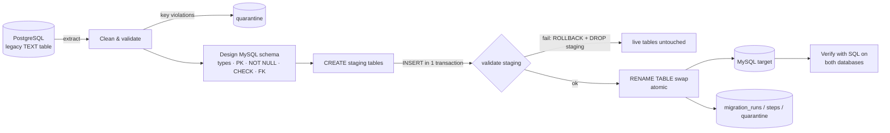

# AI Data Migration Agent

Migrates a **dirty legacy PostgreSQL table** into a **clean, typed, constrained MySQL schema**, then **proves** the migration worked by querying both databases.

The project has two parts:

1. **PostgreSQL → MySQL migration (deterministic, no API key needed).** This is the main DBMS demo. It extracts, cleans and validates the data, designs an explicit MySQL schema (types, primary keys, NOT NULL, CHECK, optional 3NF split with foreign keys), loads through staging tables in one transaction with an atomic swap, records every run in metadata tables, and verifies the result with live SQL.
2. **Agentic LangGraph workflow (optional, uses an LLM).** An LLM profiles a dataset and proposes a cleaning plan in a restricted JSON DSL. A human approves or rejects each step, and a deterministic engine executes it. The LLM never runs code or SQL.

---

## Quick start (local, recommended for demos)

Requires Docker Desktop.

```bash
docker compose up --build
```

Open http://localhost:8501. This command starts PostgreSQL 16 and MySQL 8, seeds the dirty source tables and launches the app.

**Developing in a virtualenv instead (Python 3.12):**

```bash
docker compose up -d postgres mysql
py -3.12 -m venv venv
venv\Scripts\activate
pip install -r requirements.txt
copy .env.example .env
python data/seed_postgres.py
streamlit run app.py
```

You can open the databases directly during a demo:

```bash
docker exec -it mysql_migration_target mysql -uroot -prootpassword migration_db
docker exec -it postgres_migration_source psql -U postgres migration_db
```

---

## How a migration works



| Step | What happens | Where |
|---|---|---|
| Extract | Reads the source table from PostgreSQL | `connectors/postgres_connector.py` |
| Clean | Header normalization, whitespace, placeholder values (`N/A`, `UNKNOWN`, `-`) → NULL, currency/`55k`/`4.5/5` parsing, mixed date formats, booleans, email/phone validation, domain rules (age 16–100, money ≥ 0, ...), merging category spellings (`Markting`→`Marketing`, `COD`→`Cash on Delivery`), exact-duplicate removal. **Missing values stay NULL and are never invented.** | `etl/cleaning.py` |
| Quarantine | Rows without a primary key, or reusing a key with conflicting values, are not loaded. They are stored with their raw values in `migration_quarantine`. | `etl/cleaning.py` |
| Schema design | Explicit DDL from the cleaned data: `DECIMAL(12,2)` for money, `DATE`, `BOOLEAN`, sized `VARCHAR`, plus PK / NOT NULL / CHECK. In 3NF mode a repeating category becomes a lookup table with a `UNIQUE` key, referenced by a `FOREIGN KEY`. | `etl/sql_schema.py` |
| Load | `CREATE` staging tables → chunked `INSERT`s in **one transaction** → `ADD INDEX` → validate → **one `RENAME TABLE` statement** swaps old and new tables atomically. Any failure rolls back and drops staging, so the live tables are never half-written. | `etl/mysql_loader.py` |
| Record | Each run, its steps and its quarantined rows go into metadata tables. A `CHECK` constraint enforces `source_rows = loaded + duplicates + quarantined`. | `etl/mysql_loader.py` |
| Verify | See the next section | `etl/mysql_loader.py` |

### What "verified" means

After every run, the app executes SQL against **both** databases and shows each query next to its result:

- source `COUNT(*)` in PostgreSQL vs. loaded `COUNT(*)` in MySQL, and the **row-accounting equation**
- primary key uniqueness (`COUNT(DISTINCT pk)`)
- `SUM()` of every money column matches the cleaned data
- `NULL` count per column matches the cleaned data
- no orphan foreign keys (`LEFT JOIN ... WHERE parent IS NULL`)
- **read-back SHA-256**: every row is read back from MySQL and hashed, and the hash must equal the hash of what was loaded
- **constraint probes**: the app tries to write an invalid value (negative salary, FK to a missing row) inside a transaction. MySQL must reject it, and the transaction is rolled back.

The UI also shows `SHOW CREATE TABLE`, the constraints from `information_schema`, an ER diagram, `EXPLAIN` output before and after an index is created, and a panel of preset live queries (including a JOIN across the normalized tables).

---

## Demo data

`data/generate_dirty_data.py` (seeded, so it's reproducible) generates two legacy datasets. Each injected defect is listed in `data/dirty_data_manifest.json`, and the UI shows that list before you migrate.

| Table | Rows | Injected defects |
|---|---|---|
| `dirty_employees` | 190 | 394: mixed date formats, `$`/`k`/`USD` salaries, negative salaries, ages like `999`/`thirty`, broken emails, 4 phone formats, 10 boolean spellings, misspelled departments, placeholder statuses, exact duplicates, missing and conflicting employee IDs |
| `dirty_orders` | 248 | 426: currency prefixes and suffixes, unparseable prices, `15%`/`0.15`/`15 %` discounts, invalid quantities, category and payment-method variants, missing and duplicate order IDs |

---

## Project structure

```text
app.py                     Streamlit entry point (both tabs)
ui_demo.py                 PostgreSQL → MySQL tab: results, proof, schema, history
migration_service.py       Orchestrates extract → clean → design → load → verify
etl/
  cleaning.py              Deterministic cleaner + quarantine
  sql_schema.py            Type mapping, DDL, constraints, 3NF lookup design, identifier validation
  mysql_loader.py          Staged transactional load, atomic swap, metadata, verification
  dsl_engine.py            DSL executor used by the agentic workflow
  dsl_handlers_extended.py
connectors/                PostgreSQL, MySQL, DuckDB, MongoDB, CSV connectors
graph.py, ai_brain.py      LangGraph workflow and LLM providers (agentic tab)
profiling/                 Data profiler used by the agentic workflow
data/                      Dirty-data generator, manifest, seeder, sample CSVs
pages/                     Benchmark runner page
tests/                     Unit tests + end-to-end PostgreSQL→MySQL integration tests
docs/REPORT.md             DBMS project report
```

---

## Tests

```bash
python -m pytest tests -q
```

The integration tests in `tests/test_mysql_migration_integration.py` run whenever PostgreSQL and MySQL are reachable (`docker compose up -d postgres mysql`). They cover the flat and 3NF migrations, re-running over existing tables (the atomic swap), and a deliberately failing load that must leave the live table unchanged. GitHub Actions (`.github/workflows/tests.yml`) runs the whole suite against PostgreSQL 16 and MySQL 8 service containers on every push.

---

## Configuration

Copy `.env.example` to `.env`. The defaults match `docker-compose.yml`.

| Variable | Purpose |
|---|---|
| `PG_HOST`, `PG_PORT`, `PG_USER`, `PG_PASSWORD`, `PG_DATABASE` | Source PostgreSQL |
| `PG_SSLMODE` | `require` for hosted Postgres (Neon, Supabase) |
| `MYSQL_HOST`, `MYSQL_PORT`, `MYSQL_USER`, `MYSQL_PASSWORD`, `MYSQL_DATABASE` | Target MySQL. Non-local hosts always use verified TLS. |
| `MYSQL_SSL_CA` / `MYSQL_SSL_CA_PEM` | Custom CA as a file path or as text (for example Aiven) |
| `GROQ_API_KEY`, `GOOGLE_API_KEY`, `OPENAI_API_KEY` | Optional, agentic tab only. Users can also enter keys in the sidebar; those stay in their browser session. |
| `GROQ_MODEL`, `GEMINI_MODEL`, `OPENAI_MODEL` | Override default models when a provider retires one |

---

## Hosting (optional)

The demo is designed to run locally. To get a public link:

1. **App:** [Streamlit Community Cloud](https://streamlit.io/cloud). Deploy from this repo with `app.py` as the entry point and Python 3.12. Paste `.streamlit/secrets.toml.example`, with real values, into the app's Secrets.
2. **Source PostgreSQL:** a free Neon project. Set `PG_SSLMODE=require`, then run `python data/seed_postgres.py` once from your machine with the Neon credentials in `.env`.
3. **Target MySQL:** a real MySQL 8 such as Aiven's free tier. Paste its CA certificate into `MYSQL_SSL_CA_PEM`. *TiDB does not enforce CHECK constraints by default, so the constraint checks would fail there.*

`render.yaml` deploys to Render as an alternative. The free tier there sleeps after 15 minutes and takes about a minute to wake up.

---

## Limitations

- Data is processed in memory with pandas, which suits tables up to a few hundred thousand rows. Larger tables would need chunked extraction.
- MySQL DDL commits implicitly, so the protocol gets its atomicity from staging tables plus one `RENAME TABLE`, not from a single transaction wrapping the DDL.
- The cleaner's rules are generic but heuristic. Each decision is logged, and anything ambiguous becomes NULL or goes to quarantine instead of being guessed.
