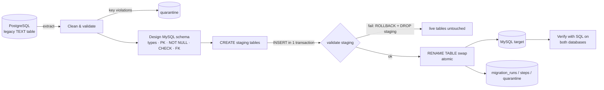

# AI Data Migration Agent

Migrates **dirty legacy data between PostgreSQL, MySQL, DuckDB, SQLite and MongoDB** (CSV upload as an extra source) into a **clean, typed, constrained schema**, then **proves** the migration worked by querying both systems.

The project has two parts:

1. **Database-to-database migration (deterministic, no API key needed).** This is the main DBMS demo. Any of the 5 systems can be the source or the target. It extracts, cleans and validates the data, designs an explicit schema for the target (types, primary keys, NOT NULL, CHECK, optional 3NF split with foreign keys), loads it atomically, records every run in metadata tables, and verifies the result with live queries.
2. **Agentic LangGraph workflow (uses an LLM: Gemini, Groq or OpenAI).** The data is profiled, the LLM recommends a cleaning plan in a restricted JSON DSL, a human approves or rejects each step, and a deterministic engine executes the approved steps and writes to any of the 5 systems. The LLM never runs code or SQL. Without an API key a rule-based planner is used instead.

---

## Quick start (local, recommended for demos)

Requires Docker Desktop.

```bash
docker compose up --build
```

Open http://localhost:8501. This command starts PostgreSQL 16, MySQL 8 and MongoDB 7, seeds the dirty source tables into all three, and launches the app. DuckDB and SQLite are database files under `runtime/`; seed them with the 🌱 button in the app.

**Developing in a virtualenv instead (Python 3.12):**

```bash
docker compose up -d postgres mysql mongodb
py -3.12 -m venv venv
venv\Scripts\activate
pip install -r requirements.txt
copy .env.example .env
python data/seed_postgres.py postgresql mysql mongodb duckdb sqlite
streamlit run app.py
```

You can open the databases directly during a demo:

```bash
docker exec -it mysql_migration_target mysql -uroot -prootpassword migration_db
docker exec -it postgres_migration_source psql -U postgres migration_db
docker exec -it mongodb_migration mongosh migration_db
```

---

## How a migration works



| Step | What happens | Where |
|---|---|---|
| Extract | Reads the source table from PostgreSQL | `connectors/postgres_connector.py` |
| Clean | Header normalization, whitespace, placeholder values (`N/A`, `UNKNOWN`, `-`) → NULL, currency/`55k`/`4.5/5` parsing, mixed date formats, booleans, email/phone validation, domain rules (age 16–100, money ≥ 0, ...), merging category spellings (`Markting`→`Marketing`, `COD`→`Cash on Delivery`), exact-duplicate removal. **Missing values stay NULL and are never invented.** | `etl/cleaning.py` |
| Quarantine | Rows without a primary key, or reusing a key with conflicting values, are not loaded. They are stored with their raw values in `migration_quarantine`. | `etl/cleaning.py` |
| Schema design | Explicit DDL from the cleaned data: `DECIMAL(12,2)` for money, `DATE`, `BOOLEAN`, sized `VARCHAR`, plus PK / NOT NULL / CHECK. In 3NF mode a repeating category becomes a lookup table with a `UNIQUE` key, referenced by a `FOREIGN KEY`. | `etl/sql_schema.py` |
| Load | Atomic on every engine (see the table below). Any failure leaves the existing target tables exactly as they were. | `etl/sql_loader.py`, `etl/mongo_loader.py` |
| Record | Each run, its steps and its quarantined rows go into metadata tables (collections in MongoDB). A `CHECK` constraint enforces `source_rows = loaded + duplicates + quarantined`. | `etl/sql_loader.py` |
| Verify | See below | `etl/sql_loader.py`, `etl/mongo_loader.py` |

### How each target is loaded atomically

| Target | Constraints | Load protocol | Index proof (EXPLAIN) |
|---|---|---|---|
| PostgreSQL | PK, NOT NULL, CHECK (`~` regex), UNIQUE, FK | **Transactional DDL**: DROP + CREATE + INSERT + CREATE INDEX in one transaction | Seq Scan on small tables (cost-based planner), explained in the UI |
| MySQL | PK, NOT NULL, CHECK (`REGEXP`), UNIQUE, FK | DDL commits implicitly, so: staging tables, INSERT transaction, **one atomic `RENAME TABLE`** | `ALL` → `ref` |
| DuckDB | PK, NOT NULL, CHECK (`regexp_full_match`), UNIQUE, FK | Transactional DDL, one transaction | stays `SEQ_SCAN` (columnar engine uses zone maps), explained in the UI |
| SQLite | PK, NOT NULL, CHECK (`GLOB`), UNIQUE, FK (`PRAGMA foreign_keys=ON`) | Transactional DDL, one transaction | `SCAN` → `SEARCH … USING INDEX` |
| MongoDB | `$jsonSchema` validator (required, bsonType, min/max, pattern), unique index for the key; no FKs, so references are checked with `$lookup` | validated staging collection, then `renameCollection(dropTarget)` (atomic per collection) | `COLLSCAN` (238 docs examined) → `IXSCAN` (3) |

### What "verified" means

After every run, the app queries **both** systems and shows each query next to its result:

- source `COUNT(*)` in PostgreSQL vs. loaded `COUNT(*)` in MySQL, and the **row-accounting equation**
- primary key uniqueness (`COUNT(DISTINCT pk)`)
- `SUM()` of every money column matches the cleaned data
- `NULL` count per column matches the cleaned data
- no orphan foreign keys (`LEFT JOIN ... WHERE parent IS NULL`)
- **read-back SHA-256**: every row is read back from MySQL and hashed, and the hash must equal the hash of what was loaded
- **constraint probes**: the app tries to write an invalid value (negative salary, FK to a missing row) inside a transaction. The target must reject it (PostgreSQL SQLSTATE 23514/23503, MySQL 3819/1452, DuckDB/SQLite constraint errors, MongoDB validation code 121), and the transaction is rolled back.

The UI also shows the table definition and constraints read back from the target's own catalog (`SHOW CREATE TABLE`, `pg_constraint`, `duckdb_constraints()`, `sqlite_master`, `listCollections`), an ER diagram, the query plan before and after an index is created, and a panel of preset live queries (including a JOIN, or `$lookup`, across the normalized tables).

---

## Demo data

`data/generate_dirty_data.py` (seeded, so it's reproducible) generates two legacy datasets. Each injected defect is listed in `data/dirty_data_manifest.json`, and the UI shows that list before you migrate.

| Table | Rows | Injected defects |
|---|---|---|
| `dirty_employees` | 190 | 394: mixed date formats, `$`/`k`/`USD` salaries, negative salaries, ages like `999`/`thirty`, broken emails, 4 phone formats, 10 boolean spellings, misspelled departments, placeholder statuses, exact duplicates, missing and conflicting employee IDs |
| `dirty_orders` | 248 | 426: currency prefixes and suffixes, unparseable prices, `15%`/`0.15`/`15 %` discounts, invalid quantities, category and payment-method variants, missing and duplicate order IDs |

---

## Project structure

```text
app.py                     Streamlit entry point (both tabs)
ui_demo.py                 Migration tab: source/target pickers, results, proof, schema, history
migration_service.py       Orchestrates extract → clean → design → load → verify
etl/
  endpoints.py             Sources/targets: PostgreSQL, MySQL, DuckDB, SQLite, MongoDB, CSV
  dialects.py              Per-engine SQL: types, CHECK syntax, catalogs, EXPLAIN, error codes
  cleaning.py              Deterministic cleaner + quarantine
  sql_schema.py            Canonical types, constraints, 3NF lookup design, identifier validation
  sql_loader.py            Atomic load for SQL engines, metadata, verification
  mongo_loader.py          $jsonSchema validators, staged load, verification for MongoDB
  dsl_engine.py            DSL executor used by the agentic workflow
  dsl_handlers_extended.py
connectors/                Connectors used by the agentic workflow (all 5 engines + CSV)
graph.py, ai_brain.py      LangGraph workflow and LLM providers (agentic tab)
profiling/                 Data profiler used by the agentic workflow
data/                      Dirty-data generator, manifest, seeder, sample CSVs
pages/                     Benchmark runner page
tests/                     Unit tests + end-to-end migration matrix across all engines
docs/REPORT.md             DBMS project report
```

---

## The AI workflow (agentic tab)

1. The source is profiled: types, missing values, placeholder values, outliers, key candidates.
2. The LLM receives the profile and returns a plan in a **restricted JSON DSL** (structured output validated with Pydantic): actions such as `replace_with_null`, `parse_currency`, `parse_datetime`, `fill_missing`, `cast_type` and `remove_duplicates`, each with a confidence score and a reason.
3. LangGraph **pauses before execution**. You see the plan and its previewed impact, and can reject individual steps or send feedback, which re-plans.
4. The deterministic DSL engine executes only the approved steps, writes to the chosen target, and reconciles the row counts.

The LLM never executes code or SQL. If the chosen model is unavailable (for example Gemini 503 "high demand"), the app tries the provider's other models, then other providers that have a key, and finally the rule-based planner. The review screen states which model produced the plan, or exactly why no LLM was used.

Set `GOOGLE_API_KEY` (or `GROQ_API_KEY` / `OPENAI_API_KEY`) in `.env`, which is gitignored. `docker compose` passes it to the app. To check the live AI connection before a demo:

```bash
RUN_LIVE_LLM=1 python -m pytest tests/test_live_llm.py -s
```

---

## Tests

```bash
python -m pytest tests -q
```

`tests/test_migration_integration.py` migrates every source into every target (5×5) and checks that every verification passes. It also covers 3NF into each target, re-running over existing tables, a deliberately failing load on each engine that must leave the live table unchanged, and the agentic workflow (pause for review, then execute). DuckDB and SQLite always run; PostgreSQL, MySQL and MongoDB run when reachable (`docker compose up -d postgres mysql mongodb`). GitHub Actions (`.github/workflows/tests.yml`) runs the whole suite against PostgreSQL 16, MySQL 8 and MongoDB 7 service containers on every push.

---

## Configuration

Copy `.env.example` to `.env`. The defaults match `docker-compose.yml`.

| Variable | Purpose |
|---|---|
| `PG_HOST`, `PG_PORT`, `PG_USER`, `PG_PASSWORD`, `PG_DATABASE` | Source PostgreSQL |
| `PG_SSLMODE` | `require` for hosted Postgres (Neon, Supabase) |
| `MYSQL_HOST`, `MYSQL_PORT`, `MYSQL_USER`, `MYSQL_PASSWORD`, `MYSQL_DATABASE` | Target MySQL. Non-local hosts always use verified TLS. |
| `MYSQL_SSL_CA` / `MYSQL_SSL_CA_PEM` | Custom CA as a file path or as text (for example Aiven) |
| `MONGO_URI`, `MONGO_DATABASE` | MongoDB source/target |
| `RUNTIME_DIR` | Where DuckDB/SQLite database files are created (default `runtime/`) |
| `GROQ_API_KEY`, `GOOGLE_API_KEY`, `OPENAI_API_KEY` | Optional, agentic tab only. Users can also enter keys in the sidebar; those stay in their browser session. |
| `GROQ_MODEL`, `GEMINI_MODEL`, `OPENAI_MODEL` | Override default models when a provider retires one |

---

## Hosting (optional)

The demo is designed to run locally. To get a public link:

1. **App:** [Streamlit Community Cloud](https://streamlit.io/cloud). Deploy from this repo with `app.py` as the entry point and Python 3.12. Paste `.streamlit/secrets.toml.example`, with real values, into the app's Secrets.
2. **Source PostgreSQL:** a free Neon project. Set `PG_SSLMODE=require`, then run `python data/seed_postgres.py` once from your machine with the Neon credentials in `.env`.
3. **Target MySQL:** a real MySQL 8 such as Aiven's free tier. Paste its CA certificate into `MYSQL_SSL_CA_PEM`. *TiDB does not enforce CHECK constraints by default, so the constraint checks would fail there.*

`render.yaml` deploys to Render as an alternative. The free tier there sleeps after 15 minutes and takes about a minute to wake up.

---

## Limitations

- Data is processed in memory with pandas, which suits tables up to a few hundred thousand rows. Larger tables would need chunked extraction.
- MySQL DDL commits implicitly, so the protocol gets its atomicity from staging tables plus one `RENAME TABLE`, not from a single transaction wrapping the DDL.
- The cleaner's rules are generic but heuristic. Each decision is logged, and anything ambiguous becomes NULL or goes to quarantine instead of being guessed.
