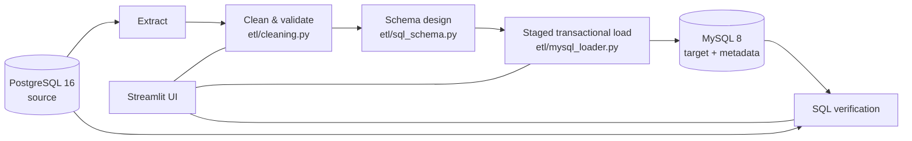
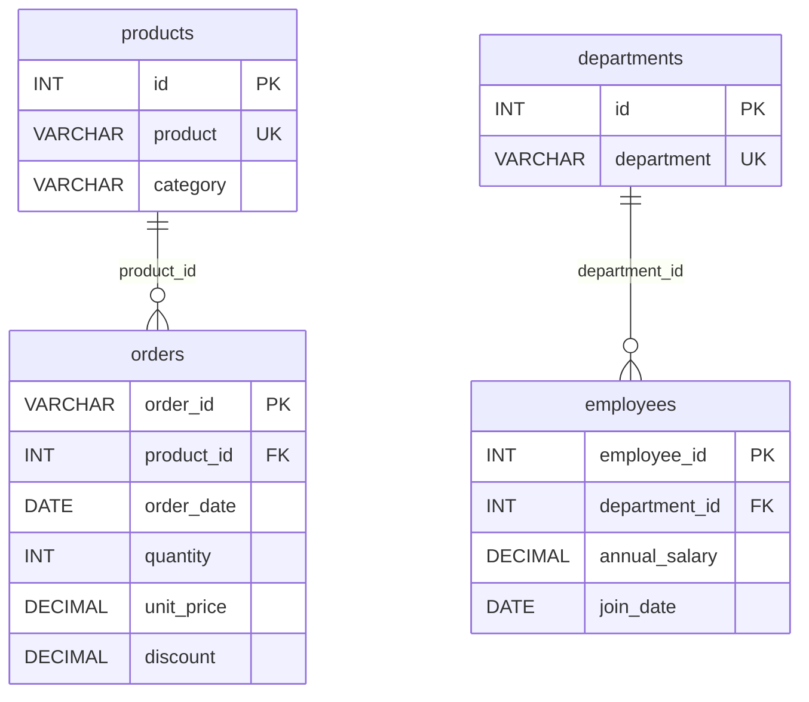
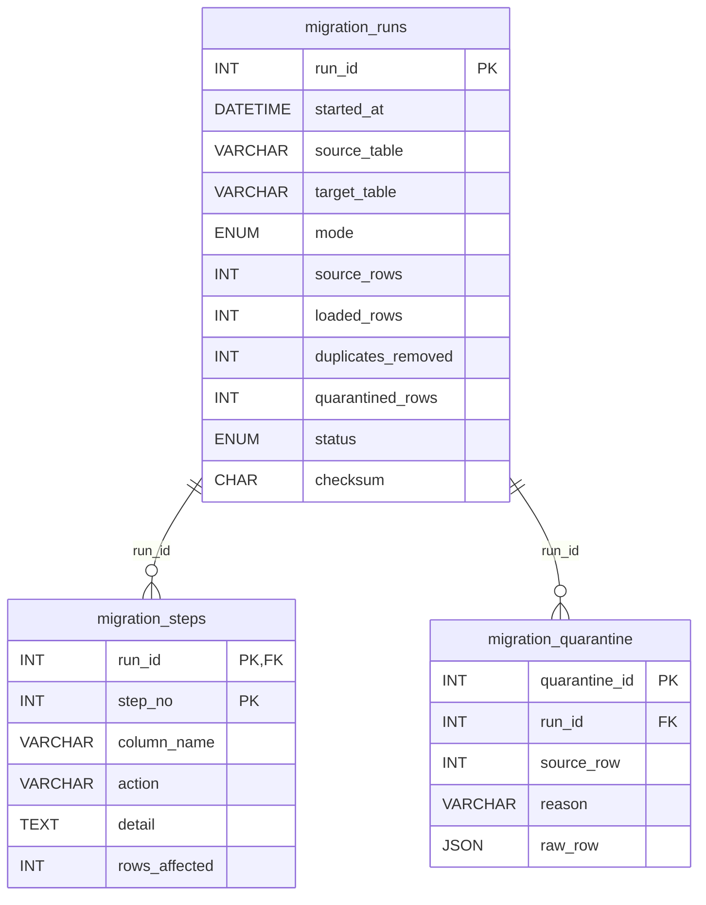

# AI Data Migration Agent: DBMS Project Report

## 1. Problem statement

Organizations moving off legacy systems face two problems at once: the **data is dirty** (inconsistent formats, placeholders, duplicates, broken keys), and the **target schema must be stricter than the source**. A migration that copies rows across with `INSERT ... SELECT` or pandas `to_sql` produces a target with guessed types, no keys and no constraints. It also gives no proof that what arrived matches what left.

This project migrates a legacy **PostgreSQL** table, where every column is `TEXT` and the data is messy, into a **MySQL 8** schema that has:

- explicit data types, primary keys, `NOT NULL`, `CHECK` and `FOREIGN KEY` constraints
- an optional **3NF decomposition** driven by functional dependencies found in the data
- a load that is **atomic**: the target is never half-written
- **verification by SQL** against both databases, including a read-back checksum

## 2. Objectives

1. Detect and repair data-quality defects deterministically, and **quarantine** (not silently drop) rows that violate entity integrity.
2. Design the target schema from the data: type mapping, constraints, keys.
3. Normalize repeating groups into separate tables where a functional dependency exists.
4. Load with ACID guarantees and recover cleanly from failure.
5. Keep an auditable record of every migration in the database itself.
6. Prove the result with SQL, not with the pipeline's own bookkeeping.

## 3. Architecture



All steps are deterministic Python. No LLM is involved in this path. A separate agentic tab (LangGraph) lets an LLM *propose* cleaning steps in a restricted DSL, but those steps are executed by the same kind of deterministic engine, and the LLM never generates SQL.

## 4. Source data

The source tables are generated by `data/generate_dirty_data.py` (random seed 42) and loaded by `data/seed_postgres.py` exactly as a legacy system would hold them: all columns `TEXT`, original header names (including spaces), blanks as empty strings. Each injected defect is recorded in `data/dirty_data_manifest.json`.

| Table | Rows | Injected defects (examples) |
|---|---|---|
| `dirty_employees` | 190 | `$124,000`, `55k`, `USD 72,500`, `-89000`; ages `999`, `thirty`, `0`; `yuki at acme-corp.com`; `(934) 854-1776`, `+91 94978 64507`; `Y`/`NO`/`TRUE`/`0`; `Markting`, `ENGINEERING`, `Human Resource`; `UNKNOWN`, `?`, `null`; 6 exact duplicates; 3 rows with no employee ID; 4 conflicting re-entries |
| `dirty_orders` | 248 | `$38.00`, `Rs. 49.50`, `29.99 USD`, `abc`; discounts `15%`, `15 %`, `0.15`; quantities `-2`, `two`; `Pay Pal`, `COD`, `Sport`, `HOME `; missing and duplicate order IDs |

## 5. Cleaning and data-quality rules

| Rule | Example | Result |
|---|---|---|
| Header normalization | ` Annual Salary ` | `annual_salary` |
| Placeholder → NULL | `N/A`, `UNKNOWN`, `-`, `?`, blank | `NULL` |
| Numeric parsing | `$1,200`, `55k`, `4.5/5` | `1200`, `55000`, `4.5` |
| Percentages | `15%`, `15 %`, `0.15` | `0.15` |
| Dates | `3/8/2021`, `2021/03/08`, `Mar 08 2021` | `2021-03-08` |
| Booleans | `Y`, `yes`, `TRUE`, `1` / `N`, `no`, `0` | `TRUE` / `FALSE` |
| Domain rules | age 16–100, money ≥ 0, quantity > 0, rating 0–5, valid email, 10-digit phone | violations → `NULL` (logged) |
| Category canonicalization | `Markting`, `MARKETING `, `COD` | `Marketing`, `Cash on Delivery` (case-insensitive grouping, then fuzzy match ≥ 0.85, or acronym match, against a much more frequent value) |
| Exact duplicates | identical rows | removed (counted) |
| Entity integrity | missing PK, or same PK with different data | **quarantined** with raw values |

Missing values are **never imputed**: putting a median salary into the target would create data that did not exist in the source. Every rule writes a log entry, and the log is stored in `migration_steps`.

**Row accounting** must always balance:

```
source_rows = loaded_rows + exact_duplicates_removed + quarantined_rows
   190      =     177     +            6             +        7          (employees)
   248      =     238     +            6             +        4          (orders)
```

## 6. Target schema design

### 6.1 Type mapping

Because the source is all-`TEXT`, target types are inferred from the cleaned values and their meaning:

| Detected meaning | MySQL type | Constraint |
|---|---|---|
| primary key (integer) | `INT` / `BIGINT` | `PRIMARY KEY` |
| money | `DECIMAL(12,2)` | `CHECK (col >= 0)` |
| percentage | `DECIMAL(5,4)` | `CHECK (col BETWEEN 0 AND 1)` |
| age | `SMALLINT` | `CHECK (col BETWEEN 16 AND 100)` |
| quantity | `INT` | `CHECK (col > 0)` |
| rating | `DECIMAL(3,1)` | `CHECK (col BETWEEN 0 AND 5)` |
| email | `VARCHAR(255)` | `CHECK (col LIKE '%_@_%._%')` |
| phone | `CHAR(10)` | `CHECK (col REGEXP '^[0-9]{10}$')` |
| boolean | `BOOLEAN` (`TINYINT(1)`) | |
| date / timestamp | `DATE` / `DATETIME` | |
| category / text | `VARCHAR(n)` sized from the data | |

A column is `NOT NULL` when the cleaned data has no NULLs in it. `DECIMAL` is used for money instead of `DOUBLE` to avoid binary floating-point rounding. When the source column is already typed, `etl/sql_schema.py:PG_TO_MYSQL` documents the standard mapping (for example `numeric(p,s)` → `DECIMAL(p,s)`, `timestamptz` → `DATETIME` in UTC, `jsonb` → `JSON`, `uuid` → `CHAR(36)`).

### 6.2 Generated DDL (employees, flat)

```sql
CREATE TABLE `employees` (
  `employee_id` INT NOT NULL,
  `full_name` VARCHAR(32) NOT NULL,
  `email_address` VARCHAR(255),
  `phone` CHAR(10) NOT NULL,
  `age` SMALLINT,
  `department` VARCHAR(32) NOT NULL,
  `region` VARCHAR(16) NOT NULL,
  `annual_salary` DECIMAL(12,2),
  `join_date` DATE,
  `is_remote` BOOLEAN NOT NULL,
  `performance_rating` DECIMAL(3,1),
  `status` VARCHAR(16),
  PRIMARY KEY (`employee_id`),
  CHECK (`email_address` LIKE '%_@_%._%'),
  CHECK (`phone` REGEXP '^[0-9]{10}$'),
  CHECK (`age` BETWEEN 16 AND 100),
  CHECK (`annual_salary` >= 0),
  CHECK (`performance_rating` BETWEEN 0 AND 5),
  INDEX `idx_join_date` (`join_date`)
) ENGINE=InnoDB DEFAULT CHARSET=utf8mb4
```

### 6.3 Normalization

The normalizer takes a column to extract and **tests the data for functional dependencies** `X → C`: for each categorical column C, does every value of X map to at most one value of C? (`etl/sql_schema.py:functional_dependents`)

**Orders: a real transitive dependency.** The data satisfies `product → category`, so the flat table has

```
order_id → product → category      (transitive dependency, violates 3NF)
```

Every order row repeats the category for its product. Changing a product's category means updating many rows, and missing one leaves the data inconsistent (an update anomaly). The decomposition is:

```
orders(order_id PK, customer_name, customer_email, order_date, product_id FK, quantity, unit_price,
       discount, payment_method, order_status, total_amount)
products(id PK, product UNIQUE, category)
```

The decomposition is **lossless**: `orders ⋈ products` on `product_id = id` reproduces every original `(order_id, product, category)` pair. A unit test checks this. It is also **dependency-preserving**, because `product → category` is enforced inside `products` through `UNIQUE(product)`.

**Employees: a reference table.** No column depends on `department` in this data, so the flat table is already in 3NF. Extracting `departments(id, department UNIQUE)` with a foreign key is a *domain/reference table*: each name is stored once, and MySQL rejects a new row whose department doesn't exist (for example `Markting`). Department-level attributes added later (head, budget) would belong in this table.



### 6.4 Migration metadata schema

Every run is recorded in the target database:



`migration_runs` has the constraint `CHECK (status = 'failed' OR source_rows = loaded_rows + duplicates_removed + quarantined_rows)`, so the database itself refuses a "successful" run whose rows don't add up. `migration_steps` uses a composite primary key `(run_id, step_no)`. Both child tables use `ON DELETE CASCADE`.

## 7. Transactions and failure handling

MySQL commits implicitly on DDL (`CREATE`, `DROP`, `RENAME`), so one transaction can't wrap both the table creation and the data. The load protocol gets atomicity anyway:

1. `CREATE TABLE <t>__stg` with the full schema (parents before children; the child's FK points at the parent's *staging* table).
2. `BEGIN; INSERT ... (chunks of 500) ...; COMMIT;`. A CHECK, FK or NOT NULL violation in any row rolls back **every** row.
3. `ALTER TABLE ... ADD INDEX`, then `ANALYZE TABLE`.
4. Validate the staging tables with SQL (row counts).
5. `RENAME TABLE t TO t__old, t__stg TO t [, lookup TO lookup__old, lookup__stg TO lookup]`. MySQL executes a multi-table `RENAME TABLE` atomically, and InnoDB re-points the foreign keys to the renamed tables.
6. `DROP TABLE t__old`.

On any failure the staging tables are dropped, the live tables are untouched, and a `failed` row is written to `migration_runs`. The integration test `test_failed_load_leaves_live_table_untouched` injects a CHECK violation mid-load and asserts that the live row count hasn't changed.

| ACID property | How it is achieved |
|---|---|
| Atomicity | Single INSERT transaction plus one atomic `RENAME TABLE`; failures roll back and drop staging |
| Consistency | PK, NOT NULL, CHECK and FK constraints are enforced by MySQL on every row; row accounting is enforced by a CHECK on `migration_runs` |
| Isolation | Readers never see staging tables under the live name; the swap is a single statement |
| Durability | InnoDB commit; run history is persisted in metadata tables |

## 8. Indexing

The first date column (`join_date`, `order_date`) gets a secondary index. The app captures `EXPLAIN` for an equality lookup before and after `ADD INDEX`. Before, `type = ALL` (full table scan over all rows). After, `type = ref` with `key = idx_join_date`, reading only the matching rows. Foreign key columns are indexed automatically by InnoDB.

## 9. Verification

These checks run after every migration. Each one is shown in the UI together with the SQL that produced it:

| Check | SQL (abridged) |
|---|---|
| Source row count | `SELECT COUNT(*) FROM "dirty_employees"` (PostgreSQL) |
| Target row count per table | `SELECT COUNT(*) FROM employees` (MySQL) |
| Row accounting | source count = target count + duplicates + quarantined |
| PK uniqueness | `SELECT COUNT(DISTINCT employee_id) FROM employees` |
| Money totals | `SELECT SUM(annual_salary) FROM employees` vs. sum of cleaned data |
| NULLs per column | `SELECT SUM(col IS NULL), ... FROM employees` |
| No orphan FKs | `SELECT COUNT(*) FROM employees m LEFT JOIN departments r ON m.department_id = r.id WHERE m.department_id IS NOT NULL AND r.id IS NULL` |
| Read-back checksum | every row is read back, canonicalized by column type, sorted and SHA-256-hashed; must equal the hash of the rows that were sent |
| Constraint enforcement | `UPDATE employees SET annual_salary = -1 WHERE ...` inside a transaction must fail with MySQL error 3819, then roll back. `UPDATE ... SET department_id = 999999` must fail with error 1452. |

## 10. Security

- Table and column names are validated against `^[A-Za-z_][A-Za-z0-9_]{0,47}$` before being quoted into SQL. All values go through bound parameters.
- Remote MySQL connections use TLS with certificate verification. Postgres supports `sslmode`.
- No credentials are stored in the code. API keys entered in the UI stay in the user's session and are passed per request, never written to the process environment.

## 11. Testing

- Unit tests: cleaning rules, quarantine and row accounting, DDL generation, functional-dependency detection with a lossless-join check, checksum canonicalization, identifier validation.
- Integration tests against real PostgreSQL and MySQL: flat and 3NF migrations of both datasets, re-running over existing tables (atomic swap, no leftover staging tables), and rollback on a failed load.
- CI: GitHub Actions runs everything against PostgreSQL 16 and MySQL 8 service containers.

## 12. Limitations and future work

- Processing is in-memory with pandas. Very large tables would need chunked extraction (server-side cursors) and chunked cleaning.
- Category canonicalization is heuristic (fuzzy matching). A production system would let a data steward confirm the mappings.
- Incremental and resumable migration (upserts with `INSERT ... ON DUPLICATE KEY UPDATE`, change data capture) is not implemented. Each run is a full refresh.
- Functional dependencies are detected from the data, which only shows that they hold in this sample. A designer should confirm them as business rules.
